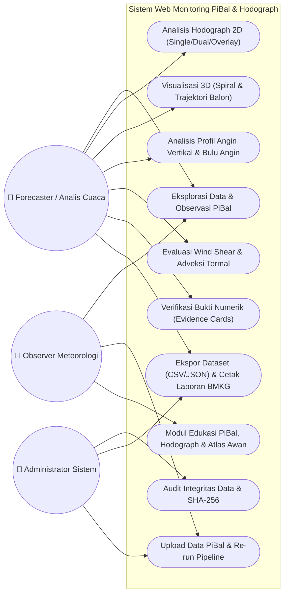
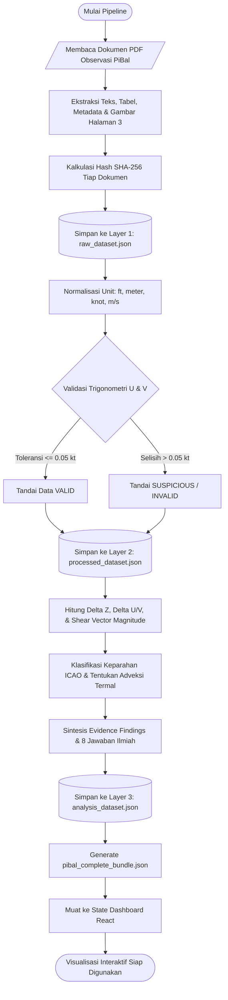
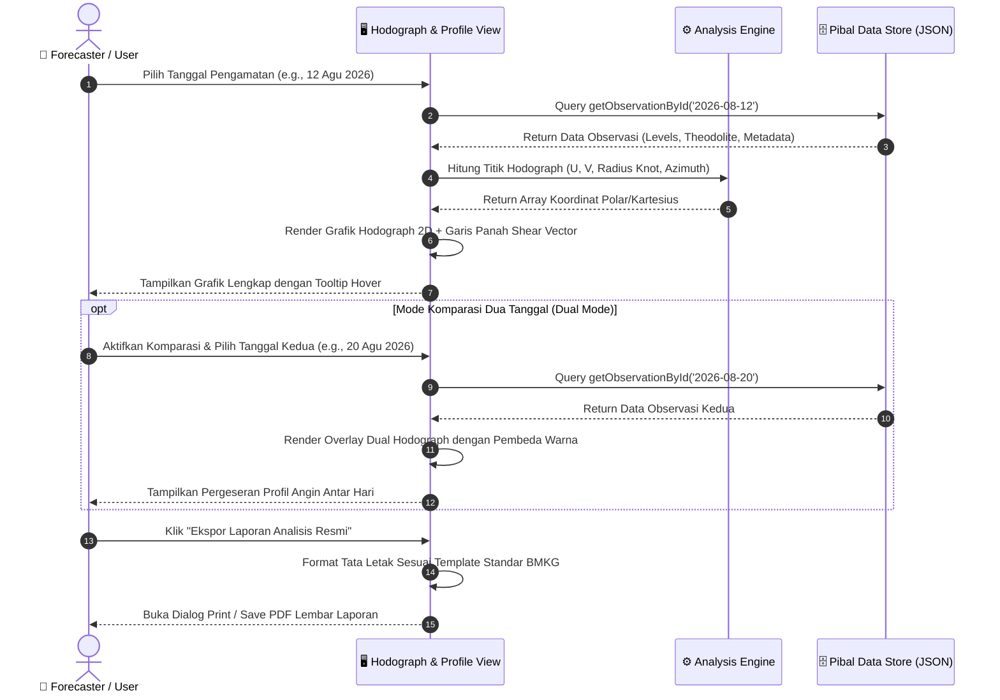
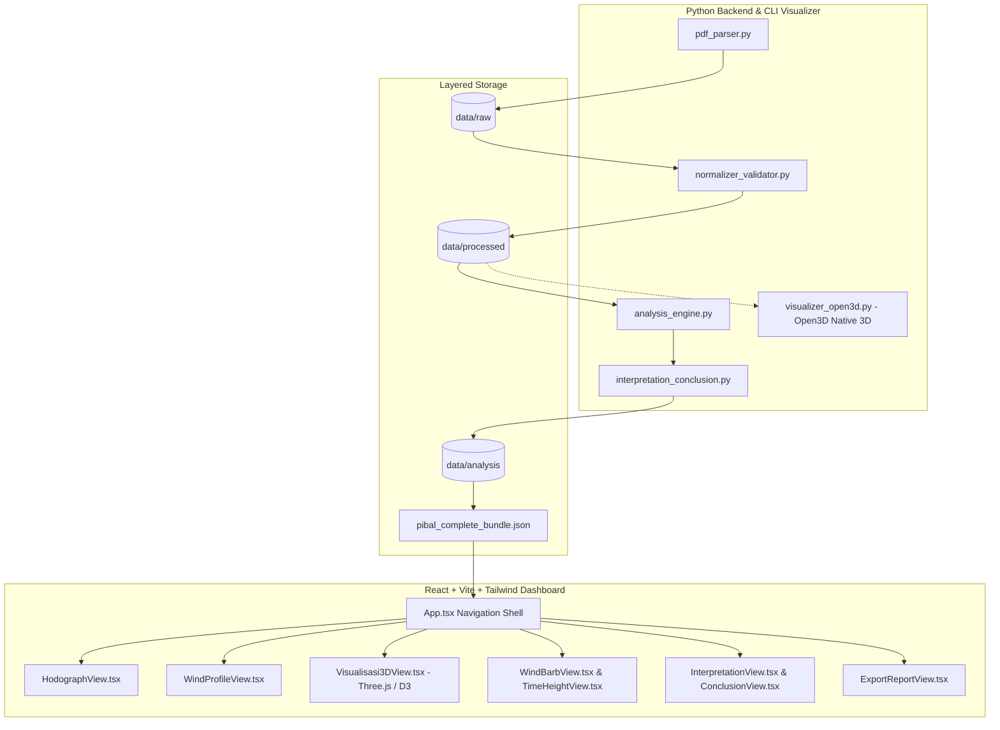
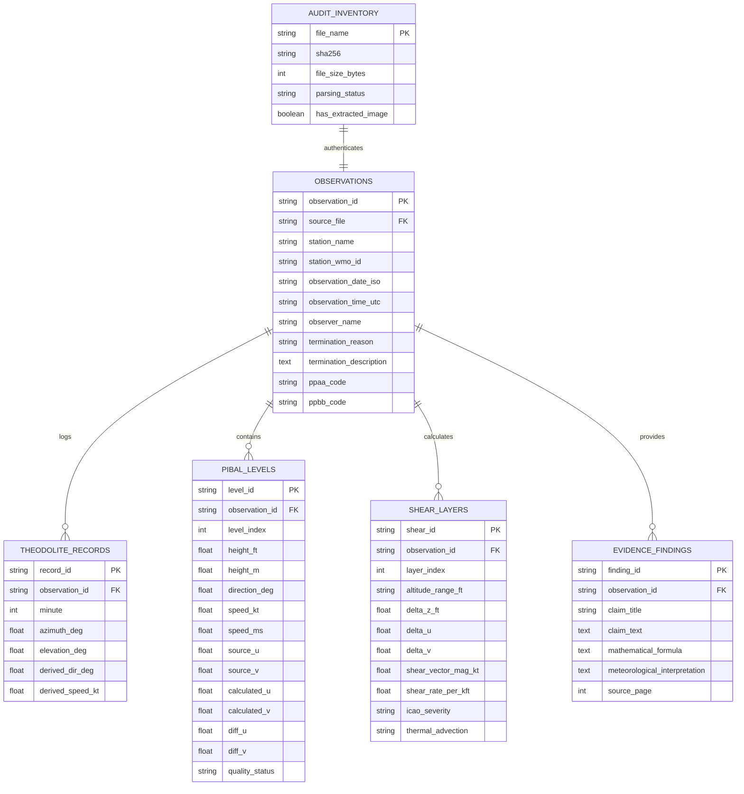

# 🎈 Web Dashboard Analisis & Monitoring PiBal (Pilot Balon) & Hodograph

<p align="center">
  
</p>

<h3 align="center">Stasiun Meteorologi Tunggul Wulung Cilacap — Badan Meteorologi, Klimatologi, dan Geofisika (BMKG)</h3>

<p align="center">
  <b>WMO ID:</b> <code>96805</code> | <b>ICAO:</b> <code>WAHL</code> | <b>Koordinat:</b> <code>07°38' LS, 109°01' BT</code> | <b>Elevasi:</b> <code>6 m MSL</code>
</p>

<p align="center">
  
  
  
  
  
  
</p>

---

## 📖 Ringkasan Eksekutif

**Monitoring PiBal (Pilot Balloon) & Hodograph** adalah sistem web analitik dan pemantauan meteorologi terpadu untuk pengamatan lapisan udara atas (*upper-air observation*). Aplikasi ini mendigitalkan, menstandardisasi, dan memvisualisasikan data pengamatan balon pilot harian dari **Stasiun Meteorologi Tunggul Wulung Cilacap (Agustus 2026)**.

Sistem memproses dokumen laporan resmi BMKG secara otomatis menjadi pipeline data bertingkat (*raw*, *processed*, *analysis*), melakukan audit integritas trigonometri $U$ & $V$ secara matematis, mengkalkulasi dinamika *wind shear* vertikal, serta menyajikan visualisasi hodograph 2D/3D interaktif dan profil kolom atmosfer standar WMO.

---

## 📑 Daftar Isi
- [Ringkasan Eksekutif](#-ringkasan-eksekutif)
- [Fitur Utama Sistem](#-fitur-utama-sistem)
- [Arsitektur Sistem](#-arsitektur-sistem)
- [Diagram UML (Unified Modeling Language)](#-diagram-uml-unified-modeling-language)
  - [1. Use Case Diagram](#1-use-case-diagram)
  - [2. Activity Diagram (Data Processing Pipeline)](#2-activity-diagram-data-processing-pipeline)
  - [3. Sequence Diagram (Analisis & Komparasi)](#3-sequence-diagram-analisis--komparasi)
  - [4. Component / Architecture Diagram](#4-component--architecture-diagram)
- [Entity Relationship Diagram (ERD) & Kamus Data](#-entity-relationship-diagram-erd--kamus-data)
  - [1. Diagram ERD](#1-diagram-erd)
  - [2. Kamus Data & Spesifikasi Tabel](#2-kamus-data--spesifikasi-tabel)
- [Landasan Ilmiah & Formula Meteorologi](#-landasan-ilmiah--formula-meteorologi)
- [Struktur Direktori Proyek](#-struktur-direktori-proyek)
- [Panduan Instalasi & Pengoperasian](#-panduan-instalasi--pengoperasian)
- [Pengujian Otomatis & Verifikasi Data](#-pengujian-otomatis--verifikasi-data)
- [Kontributor & Lisensi](#-kontributor--lisensi)

---

## 🌟 Fitur Utama Sistem

Sistem terdiri dari **17 modul tampilan komprehensif**:

1. **Ringkasan Eksekutif (Overview View)**
   - Dashboard KPI: 21 observasi harian, 172 level teramati, ketinggian puncak s.d. 35.000 ft, kecepatan maksimum 30 knot.
   - Grafik sebaran kecepatan puncak, ketinggian terminasi balon, dan proporsi observer.
2. **Eksplorasi Data PiBal (Data Explorer)**
   - Penjelajahan 21 observasi atau 172 baris data level individual dengan filter tanggal, pencarian, dan sorting.
   - Modal detail data per menit theodolit (azimuth, elevasi) dan kode sandi WMO (**PPAA** & **PPBB**).
3. **Analisis Hodograph Interaktif (Hodograph 2D)**
   - Bidang koordinat polar/U-V kartesius dengan cincin isotach konsentris (5, 10, 15, 20, 25, 30 knot).
   - Mode *Single Day*, *Dual Comparison* (komparasi 2 tanggal), dan *Multi-Day Overlay* (21 hari sekaligus).
   - Verifikasi berdampingan (*side-by-side*) 1:1 dengan citra grafik asli dari Halaman 3 dokumen sumber PDF.
4. **Visualisasi 3D Interaktif (3 Mesin Grafis)**
   - **D3.js SVG 3D Engine**: Proyeksi matriks rotasi matematis dinamis (*Yaw*, *Pitch*, *Zoom*), kurva *spline* Catmull-Rom, dan *Painter's depth sorting algorithm*.
   - **WebGL Three.js Engine**: Rendering GPU interaktif dengan efek pencahayaan dinamis dan atmosferik.
   - **Native Desktop Open3D Engine (`visualizer_open3d.py`)**: Visualisasi OpenGL akselerasi hardware untuk trajektori fisik balon dan ekspor format 3D `.ply`.
5. **Bulu Angin (Wind Barbs) & Time-Height Curtain**
   - Kolom vertikal simbol bulu angin presisi standar WMO (pennant 50 kt, full barb 10 kt, half barb 5 kt).
   - Matriks synoptic *Time-Height Curtain* 21 hari x level ketinggian atmosfer.
   - Simulator & dekomposer bulu angin interaktif.
6. **Profil Angin Vertikal (Wind Profile)**
   - 4 plot vertikal kontinu: Kecepatan vs Ketinggian, Arah vs Ketinggian, Zonal $U$, dan Meridional $V$.
   - Fitur toggle satuan metrik (Knot/Feet $\leftrightarrow$ m/s / Meter).
7. **Statistik Vertikal & Analisis Wind Shear**
   - Perhitungan otomatis $\Delta z$, $\Delta U$, $\Delta V$, magnitudo vektor shear, dan *shear rate* per 1.000 ft.
   - Klasifikasi tingkat keparahan standar ICAO (*Light*, *Moderate*, *Severe*).
   - Identifikasi adveksi termal lapisan (*Warm Advection* / *Cold Advection*).
8. **Interpretasi Otomatis Berbasis Bukti (Evidence-Based Findings)**
   - Kartu temuan transparan: Klaim Ilmiah $\rightarrow$ Bukti Numerik $\rightarrow$ Rumus $\rightarrow$ Interpretasi $\rightarrow$ Sumber PDF.
9. **Konklusi Analisis Saintifik**
   - Menjawab secara tuntas 8 pertanyaan kunci analisis meteorologi atmosfer lapisan atas.
10. **Modul Edukasi PiBal & Hodograph**
    - Pembahasan alat theodolit optik, hukum trigonometri balon pilot, dan dinamika Belahan Bumi Selatan (BBS).
11. **Atlas Awan (Cloud Atlas)**
    - Katalog 10 genus awan internasional WMO untuk panduan observer di lapangan.
12. **Kuis Interaktif Meteorologi**
    - Evaluasi pemahaman meteorologi upper-air dan hodograph secara interaktif.
13. **Data Upload & Custom Processing**
    - Antarmuka pengunggahan data observasi mandiri dengan validasi instan.
14. **Audit Kualitas & Keterlacakan (Traceability)**
    - Verifikasi hash kriptografis SHA-256 pada seluruh dokumen sumber serta audit matematis $U$ & $V$.
15. **Pusat Ekspor & Pelaporan**
    - Ekspor data tabular ke CSV, JSON, serta generator lembar laporan resmi berformat BMKG siap cetak.

---

## 🏛️ Arsitektur Sistem

```
┌────────────────────────────────────────────────────────────────────────┐
│                        DATA SOURCE (PDF & CSV)                         │
│   21 Dokumen Observasi PiBal Resmi Stasiun Meteorologi Cilacap         │
└───────────────────────────────────┬────────────────────────────────────┘
                                    │
                                    ▼
┌────────────────────────────────────────────────────────────────────────┐
│                   PYTHON DATA PROCESSING PIPELINE                      │
│ ┌───────────────────┐  ┌─────────────────────┐  ┌──────────────────┐   │
│ │   pdf_parser.py   │─►│normalizer_validator │─►│analysis_engine.py│   │
│ │  (PyMuPDF Extract)│  │ (Audit UV & Status) │  │(Shear & Stats)   │   │
│ └───────────────────┘  └─────────────────────┘  └────────┬─────────┘   │
│                                                          ▼             │
│                                              ┌───────────────────────┐ │
│                                              │interpretation_engine  │ │
│                                              └───────────┬───────────┘ │
└──────────────────────────────────────────────────────────┼─────────────┘
                                                           ▼
┌────────────────────────────────────────────────────────────────────────┐
│                  DATA STORAGE / LAYERED JSON ARTIFACTS                 │
│  data/raw/ ──► data/processed/ ──► data/analysis/ ──► pibalData.json   │
└───────────────────────────────────┬────────────────────────────────────┘
                                    │
                                    ▼
┌────────────────────────────────────────────────────────────────────────┐
│             FRONTEND DASHBOARD & VISUALIZATION (REACT 18)              │
│  ┌───────────────────────┬──────────────────────┬────────────────────┐ │
│  │   2D & Chart Views    │   3D Visualizers     │ Education & Quiz   │ │
│  │  (Hodograph, Profile, │ (D3.js, Three.js,    │ (Atlas Awan, WMO   │ │
│  │   Barbs, Time-Height) │  Open3D Desktop)     │  Guide, Simulator) │ │
│  └───────────────────────┴──────────────────────┴────────────────────┘ │
└────────────────────────────────────────────────────────────────────────┘
```

---

## 📊 Diagram UML (Unified Modeling Language)

### 1. Use Case Diagram
Menggambarkan peran dan interaksi pengguna sistem:



### 2. Activity Diagram (Data Processing Pipeline)
Alur pengolahan data dari dokumen mentah hingga siap dianalisis pada dashboard:



### 3. Sequence Diagram (Analisis & Komparasi)
Interaksi antara Analis Cuaca, Antarmuka Dashboard, State Store, dan Modul Perhitungan:



### 4. Component / Architecture Diagram
Struktur modular antar komponen dalam ekosistem aplikasi:



---

## 🗃 Entity Relationship Diagram (ERD) & Kamus Data

### 1. Diagram ERD

Relasi logis antar entitas data pengamatan Pilot Balon:



---

### 2. Kamus Data & Spesifikasi Tabel

#### A. Tabel `OBSERVATIONS` (Entitas Utama Metadata Observasi)
| Nama Atribut | Tipe Data | Constraint | Keterangan |
|---|---|---|---|
| `observation_id` | VARCHAR(32) | PRIMARY KEY | ID unik pengamatan (format: `YYYY-MM-DD_HHUTC`) |
| `source_file` | VARCHAR(128) | FOREIGN KEY (`AUDIT_INVENTORY.file_name`) | Nama file PDF sumber BMKG |
| `station_name` | VARCHAR(64) | NOT NULL | Nama stasiun (e.g., `Stasiun Meteorologi Tunggul Wulung Cilacap`) |
| `station_wmo_id` | VARCHAR(10) | NOT NULL | Kode identitas resmi WMO (`96805`) |
| `observation_date_iso` | DATE | NOT NULL | Tanggal pengamatan dalam standar ISO-8601 (`YYYY-MM-DD`) |
| `observation_time_utc` | VARCHAR(10) | NOT NULL | Waktu rilis observasi dalam UTC (e.g., `06.00 UTC`) |
| `observer_name` | VARCHAR(64) | NOT NULL | Nama petugas pengamat meteorologi yang bertugas |
| `termination_reason` | VARCHAR(10) | NOT NULL | Kode terminasi pelepasan balon (e.g., `LL`, `LIC`, `HZ`, `BB`) |
| `termination_description` | VARCHAR(255) | NOT NULL | Penjelasan terminasi (e.g., `Lost in Distance`, `Lost in Cloud`) |
| `ppaa_code` | TEXT | NULL | Kode transmisi sandi meteorologi WMO PPAA |
| `ppbb_code` | TEXT | NULL | Kode transmisi sandi meteorologi WMO PPBB |

#### B. Tabel `THEODOLITE_RECORDS` (Data Mentah Pembacaan Optik Menit-ke-Menit)
| Nama Atribut | Tipe Data | Constraint | Keterangan |
|---|---|---|---|
| `record_id` | VARCHAR(48) | PRIMARY KEY | ID komposit unik record theodolit |
| `observation_id` | VARCHAR(32) | FOREIGN KEY (`OBSERVATIONS.observation_id`) | Relasi ke entitas observasi utama |
| `minute` | INT | NOT NULL | Menit ke-n sejak pelepasan balon (1 s.d. 35) |
| `azimuth_deg` | DECIMAL(5,2) | NULL | Sudut azimuth theodolit terhadap arah utara (0° - 360°) |
| `elevation_deg` | DECIMAL(5,2) | NULL | Sudut elevasi vertikal theodolit (0° - 90°) |
| `derived_dir_deg` | DECIMAL(5,2) | NULL | Arah angin turunan dari perpindahan balon |
| `derived_speed_kt` | DECIMAL(5,2) | NULL | Kecepatan angin turunan (knot) |

#### C. Tabel `PIBAL_LEVELS` (Data Tingkat Ketinggian & Vektor Angin)
| Nama Atribut | Tipe Data | Constraint | Keterangan |
|---|---|---|---|
| `level_id` | VARCHAR(48) | PRIMARY KEY | ID unik tingkat ketinggian pengamatan |
| `observation_id` | VARCHAR(32) | FOREIGN KEY (`OBSERVATIONS.observation_id`) | Relasi ke entitas observasi utama |
| `level_index` | INT | NOT NULL | Indeks urutan ketinggian (dimulai dari level permukaan) |
| `height_ft` | DECIMAL(8,2) | NOT NULL | Ketinggian lapisan dalam satuan kaki (*feet*) |
| `height_m` | DECIMAL(8,2) | NOT NULL | Ketinggian lapisan dalam satuan meter ($1\text{ ft} = 0.3048\text{ m}$) |
| `direction_deg` | DECIMAL(5,2) | NOT NULL | Arah asal angin (° geodetik) |
| `speed_kt` | DECIMAL(5,2) | NOT NULL | Kecepatan angin dalam knot |
| `speed_ms` | DECIMAL(5,2) | NOT NULL | Kecepatan angin dalam meter per detik ($1\text{ kt} \approx 0.51444\text{ m/s}$) |
| `source_u` | DECIMAL(6,2) | NOT NULL | Komponen zonal $U$ yang tercantum pada dokumen PDF |
| `source_v` | DECIMAL(6,2) | NOT NULL | Komponen meridional $V$ yang tercantum pada dokumen PDF |
| `calculated_u` | DECIMAL(6,2) | NOT NULL | Komponen zonal $U$ hasil kalkulasi independen |
| `calculated_v` | DECIMAL(6,2) | NOT NULL | Komponen meridional $V$ hasil kalkulasi independen |
| `diff_u` | DECIMAL(6,4) | NOT NULL | Selisih mutlak $\|U_{\text{sumber}} - U_{\text{hitung}}\|$ |
| `diff_v` | DECIMAL(6,4) | NOT NULL | Selisih mutlak $\|V_{\text{sumber}} - V_{\text{hitung}}\|$ |
| `quality_status` | ENUM | NOT NULL | Status verifikasi data: `VALID`, `SUSPICIOUS`, atau `INVALID` |

#### D. Tabel `SHEAR_LAYERS` (Analisis Lapisan Geser Angin Vertikal)
| Nama Atribut | Tipe Data | Constraint | Keterangan |
|---|---|---|---|
| `shear_id` | VARCHAR(48) | PRIMARY KEY | ID unik lapisan geser angin |
| `observation_id` | VARCHAR(32) | FOREIGN KEY (`OBSERVATIONS.observation_id`) | Relasi ke entitas observasi |
| `layer_index` | INT | NOT NULL | Urutan lapisan geser antar level berdekatan |
| `altitude_range_ft` | VARCHAR(32) | NOT NULL | Rentang lapisan ketinggian (e.g., `1000 - 2000 ft`) |
| `delta_z_ft` | DECIMAL(8,2) | NOT NULL | Ketebalan vertikal lapisan ($\Delta z$) |
| `delta_u` | DECIMAL(6,2) | NOT NULL | Selisih komponen zonal ($U_{\text{top}} - U_{\text{bottom}}$) |
| `delta_v` | DECIMAL(6,2) | NOT NULL | Selisih komponen meridional ($V_{\text{top}} - V_{\text{bottom}}$) |
| `shear_vector_mag_kt` | DECIMAL(6,2) | NOT NULL | Magnitudo vektor geser $\|\Delta \vec{V}\|$ (knot) |
| `shear_rate_per_kft` | DECIMAL(6,2) | NOT NULL | Laju geser ternormalisasi per 1.000 kaki |
| `icao_severity` | ENUM | NOT NULL | Kategori ICAO: `LIGHT`, `MODERATE`, `SEVERE` |
| `thermal_advection` | ENUM | NOT NULL | Adveksi termal lapisan: `WARM`, `COLD`, atau `NEUTRAL` |

#### E. Tabel `AUDIT_INVENTORY` (Audit Integritas Kriptografis Berkas)
| Nama Atribut | Tipe Data | Constraint | Keterangan |
|---|---|---|---|
| `file_name` | VARCHAR(128) | PRIMARY KEY | Nama dokumen PDF sumber resmi |
| `sha256` | CHAR(64) | NOT NULL | Hash kriptografis SHA-256 untuk bukti anti-tamper |
| `file_size_bytes` | BIGINT | NOT NULL | Ukuran fisik file dalam byte |
| `parsing_status` | VARCHAR(32) | NOT NULL | Status keberhasilan ekstraksi parser |
| `has_extracted_image`| BOOLEAN | NOT NULL | Ketersediaan gambar grafik hodograph dari halaman 3 |

---

## 📐 Landasan Ilmiah & Formula Meteorologi

### 1. Dekomposisi Komponen Angin Zonal ($U$) dan Meridional ($V$)
Arah angin meteorologi $\theta$ adalah arah **asal datangnya** angin (0° = Utara, 90° = Timur, 180° = Selatan, 270° = Barat):
$$U = -V_{\text{speed}} \cdot \sin\left(\frac{\theta \cdot \pi}{180}\right)$$
$$V = -V_{\text{speed}} \cdot \cos\left(\frac{\theta \cdot \pi}{180}\right)$$

### 2. Magnitudo Vektor Wind Shear & Laju Geser Vertikal
Antara dua lapisan ketinggian $z_1$ dan $z_2$ dengan ketebalan vertikal $\Delta z = z_2 - z_1$:
$$|\Delta \vec{V}| = \sqrt{(U_2 - U_1)^2 + (V_2 - V_1)^2} \quad (\text{knot})$$
$$\text{Shear Rate} = \frac{|\Delta \vec{V}|}{\Delta z} \times 1000 \quad (\text{knot per 1.000 ft})$$

**Klasifikasi Standar Keparahan ICAO (International Civil Aviation Organization):**
- **Ringan (Light):** $< 4.0\text{ kt} / 1.000\text{ ft}$
- **Sedang (Moderate):** $4.0 - 8.0\text{ kt} / 1.000\text{ ft}$
- **Kuat / Ekstrem (Severe):** $> 8.0\text{ kt} / 1.000\text{ ft}$

### 3. Dinamika Angin Termal di Belahan Bumi Selatan (BBS Cilacap 07°38' LS)
Karena parameter Coriolis bernilai negatif di Belahan Bumi Selatan ($f = 2\Omega \sin\phi < 0$):
- **Backing** (Vektor angin berotasi berlawanan arah jarum jam terhadap ketinggian): $\Delta \theta < 0 \rightarrow$ **Adveksi Hangat (*Warm Advection*)**
- **Veering** (Vektor angin berotasi searah jarum jam terhadap ketinggian): $\Delta \theta > 0 \rightarrow$ **Adveksi Dingin (*Cold Advection*)**

---

## 📁 Struktur Direktori Proyek

```text
monitoring_piball/
├── data/
│   ├── raw/
│   │   └── raw_dataset.json             # Layer 1: Data teks mentah ekstraksi PDF
│   ├── processed/
│   │   └── processed_dataset.json       # Layer 2: Data ternormalisasi & tervalidasi
│   ├── analysis/
│   │   └── analysis_dataset.json        # Layer 3: Hasil analisis, shear, & konklusi
│   ├── extracted_images/                # 21 gambar hodograph asli dari Hal 3 PDF
│   ├── dataset_inventory.json           # Log audit SHA-256 dan metadata 21 file
│   └── pibal_complete_bundle.json       # Bundle data terpadu untuk frontend
├── pipeline/
│   ├── pdf_parser.py                    # Parser PDF modular dinamis & case-insensitive
│   ├── normalizer_validator.py          # Normalisasi satuan & audit konsistensi trigonometri
│   ├── analysis_engine.py               # Engine kalkulasi statistik vertikal & wind shear
│   ├── interpretation_conclusion.py     # Engine narasi bukti numerik & 8 konklusi ilmiah
│   ├── open3d_visualizer.py             # Engine grafis 3D akselerasi OpenGL
│   └── run_pipeline.py                  # Runner eksekusi end-to-end data pipeline
├── dashboard/                           # Web Dashboard Interaktif (React 18 + Vite + Tailwind)
│   ├── src/
│   │   ├── components/                  # MetricCard, SourceBadge, Navbar, Modal
│   │   ├── views/                       # 17 Modul tampilan analisis & edukasi
│   │   ├── types/                       # Definisi antarmuka data TypeScript (pibal.ts)
│   │   ├── data/                        # Salinan bundle JSON untuk mode build statis
│   │   └── App.tsx                      # Navigasi & shell utama aplikasi
│   ├── package.json
│   ├── tailwind.config.js
│   └── vite.config.ts
├── tests/
│   └── test_pipeline.py                 # Rangkaian pengujian unit & integrasi
├── run_dashboard.py                     # Script peluncur web dashboard instan
├── visualizer_open3d.py                 # Script visualizer 3D desktop interaktif
├── Panduan_PiBal_Hodograph.md           # Panduan materi edukasi meteorologi PiBal
├── implementation_requirements.md       # Dokumen spesifikasi teknis acuan
├── requirements.txt                     # Daftar dependensi modul Python
└── README.md                            # Dokumentasi resmi proyek
```

---

## 🚀 Panduan Instalasi & Pengoperasian

### 1. Prasyarat Sistem
- **Python:** Versi `3.10` atau yang lebih baru
- **Node.js:** Versi `18.x` atau yang lebih baru
- **Git**

### 2. Kloning & Persiapan Lingkungan

```bash
# Kloning repositori
git clone https://github.com/username/monitoring_piball.git
cd monitoring_piball

# Buat virtual environment Python & aktifkan
python -m venv .venv
# Di Windows PowerShell:
.\.venv\Scripts\Activate.ps1
# Di Linux/macOS:
source .venv/bin/activate

# Pasang pustaka Python yang dibutuhkan
pip install -r requirements.txt
```

### 3. Menjalankan Web Dashboard Interaktif

**Opsi A — Paling Praktis (Satu Perintah Python):**
```bash
python run_dashboard.py
```
*Script ini otomatis menyajikan static bundle produksi dan membuka browser Anda di `http://localhost:5173`.*

**Opsi B — Menjalankan Frontend Development Server (Vite Hot-Reload):**
```bash
cd dashboard
npm install
npm run dev
```

### 4. Menjalankan Ulang Pipeline Ekstraksi Data
Apabila dokumen PDF baru ditambahkan atau logika ekstraksi diperbarui:
```bash
python pipeline/run_pipeline.py
```

### 5. Menjalankan Visualisasi 3D Desktop (Open3D)
Aplikasi visualisasi 3D native dengan kontrol kamera mouse orbit 360°:
```bash
# Mode Spiral Hodograph 3D (U - V - Ketinggian):
python visualizer_open3d.py --mode spiral --date 2026-08-12

# Mode Trajektori Fisik Balon 3D (dari Azimuth & Elevasi Theodolit):
python visualizer_open3d.py --mode trajectory --date 2026-08-12

# Mode Tumpukan Multi-Hari (Multi-Day Overlay 21 Observasi):
python visualizer_open3d.py --mode overlay

# Ekspor seluruh model 3D ke format standar .PLY:
python visualizer_open3d.py --export
```

---

## 🧪 Pengujian Otomatis & Verifikasi Data

Seluruh modul pipeline dilengkapi rangkaian pengujian otomatis (*unit & integration tests*):

```bash
python -m unittest discover -s tests -p "test_*.py"
```

**Verifikasi yang dijamin oleh test suite:**
1. **Integritas Trigonometri:** 100% dari 172 level teramati memiliki selisih $\|U_{\text{sumber}} - U_{\text{hitung}}\| \le 0.05\text{ kt}$ dan $\|V_{\text{sumber}} - V_{\text{hitung}}\| \le 0.05\text{ kt}$.
2. **Keterlacakan Kriptografis:** Seluruh 21 file PDF memiliki ringkasan hash SHA-256 yang tervalidasi.
3. **Validitas Sandi WMO:** Parser sandi PPAA dan PPBB terekstraksi sesuai format sandi meteorologi internasional.

---

## 👥 Pengembang & Lisensi

- **Stasiun Pengamatan:** Stasiun Meteorologi Tunggul Wulung Cilacap — BMKG
- **Lisensi:** Proyek ini dilisensikan di bawah [MIT License](LICENSE).
- **Standar Dokumen:** Sesuai panduan *World Meteorological Organization (WMO)* No. 9 dan No. 306.
